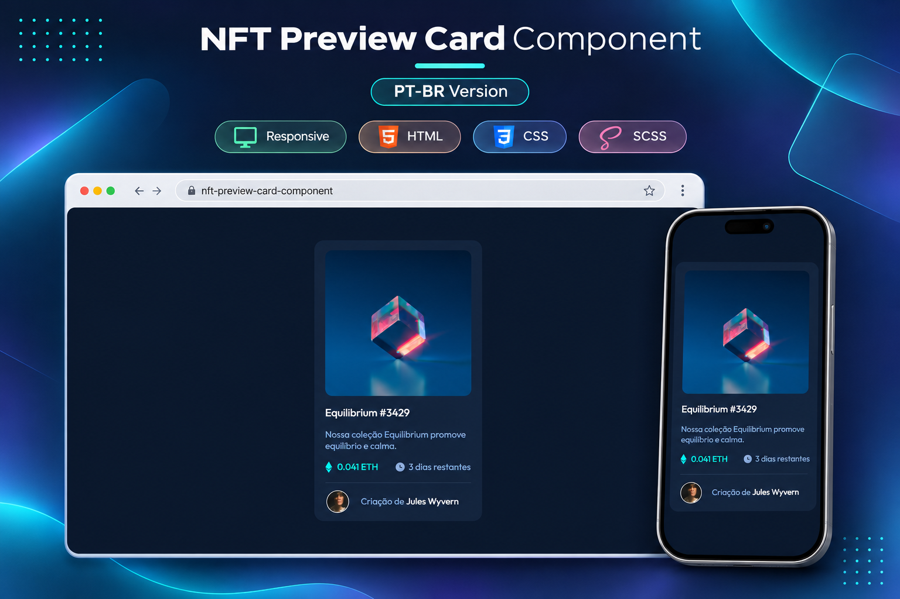

<div align="center">

# NFT Preview Card Component — PT-BR

**A responsive NFT preview card built for a Frontend Mentor challenge, with the interface adapted to Brazilian Portuguese.**

[Live Demo](https://gustavovitors.github.io/NFT-preview-card-component/) · [Source Code](https://github.com/GustavoVitorS/NFT-preview-card-component) · [Frontend Mentor Challenge](https://www.frontendmentor.io/challenges/nft-preview-card-component-SbdUL_w0U)

</div>



## Overview

This project is my solution to the [NFT Preview Card Component](https://www.frontendmentor.io/challenges/nft-preview-card-component-SbdUL_w0U) challenge on Frontend Mentor. It recreates a compact NFT information card with responsive styling and an interface written in **Brazilian Portuguese (PT-BR)**.

The design presents the *Equilibrium #3429* artwork, a short collection description, an example price in ETH, the remaining-time label, and the creator attribution. The NFT name **Equilibrium** is intentionally kept in its original form.

## Features

- **Responsive card layout** for desktop and mobile screen sizes.
- **Brazilian Portuguese content** for the description, remaining time, and creator attribution.
- **Original NFT artwork and supporting icons** for Ethereum, time remaining, and the creator avatar.
- **CSS hover effects**: the artwork displays a viewing icon and color overlay; the NFT title and creator name change color on hover.
- **SCSS source organization** with partial files for reusable variables, mixins, resets, and card styling.

> **Project scope:** This is a static frontend component. The ETH value and remaining time are display content, not live blockchain data. Hover effects are visual only: there is no NFT purchase, wallet connection, or JavaScript-powered behavior.

## Built With

| Technology | Purpose |
| --- | --- |
| **HTML5** | Page structure and PT-BR content. |
| **CSS3** | Layout, responsive breakpoints, colors, and hover states. |
| **SCSS (Sass)** | Source styles with variables, mixins, and component partials. |

The webpage loads the already-compiled `css/style.css` stylesheet. Its SCSS source files are kept in `sass/`. **No JavaScript is used.**

## Live Demo

- **Live website:** [View the NFT Preview Card](https://gustavovitors.github.io/NFT-preview-card-component/)
- **GitHub repository:** [View the source code](https://github.com/GustavoVitorS/NFT-preview-card-component)

## Project Structure

```text
NFT-preview-card-component/
├── index.html                        # PT-BR page markup
├── README.md                         # Project documentation
├── docs/
│   └── nft-preview-card-showcase.png # README presentation image
├── images/
│   ├── image-equilibrium.jpg         # NFT artwork
│   ├── image-avatar.png              # Creator portrait
│   ├── icon-ethereum.svg             # ETH symbol
│   ├── icon-clock.svg                # Remaining-time icon
│   ├── icon-view.svg                 # Hover-state icon
│   └── favicon-32x32.png             # Browser icon
├── css/
│   └── style.css                     # Compiled stylesheet
└── sass/
    ├── style.scss                    # SCSS entry point
    ├── _card.scss                    # Card and hover styles
    ├── _common.scss                  # Shared styles
    ├── _mixins.scss                  # Reusable mixins
    ├── _reset.scss                   # Style reset
    └── _variables.scss               # Design variables
```

## Run Locally

This is a static HTML and CSS project. No dependency installation or build step is required to view the current site.

1. Clone the repository:

   ```bash
   git clone https://github.com/GustavoVitorS/NFT-preview-card-component.git
   ```

2. Enter the project directory:

   ```bash
   cd NFT-preview-card-component
   ```

3. Open `index.html` in your browser or launch it with **Live Server** in VS Code.

If you choose to modify the SCSS source later, compile `sass/style.scss` to `css/style.css` using a Sass compiler. Compiling is optional for viewing the existing page.

## Credits

- **Original design and challenge:** [Frontend Mentor — NFT Preview Card Component](https://www.frontendmentor.io/challenges/nft-preview-card-component-SbdUL_w0U)
- **Implementation and Brazilian Portuguese adaptation:** [Gustavo Vitor de Souza](https://github.com/GustavoVitorS)

The presentation image showcases the existing implementation; it does not represent a redesign or additional features.
